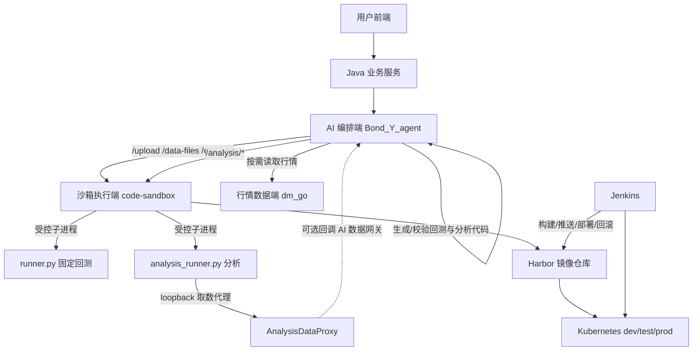
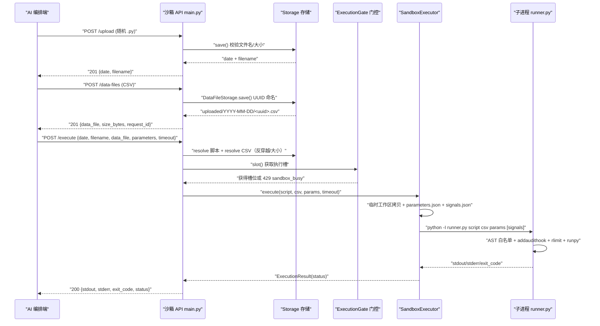
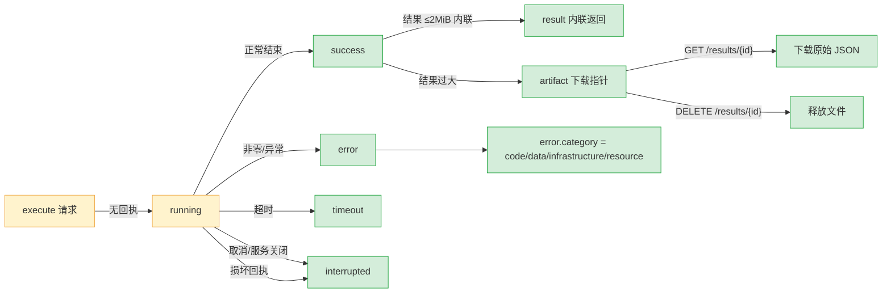

# 项目技术全景与架构交接文档（Code Sandbox Service）

> 文档定位：面向接手人与研发负责人的开箱即用交接材料。基于 **2026-10-15** 的代码、`git log` 与测试基线做静态逆向整理。
> 本文档对“已实现且有单测保障”与“仅骨架/未联调”做了明确区分，请以第六、七部分为准判断边界。

---

## 1. 项目基本信息与交接导读

| 项目 | 内容 |
| --- | --- |
| 项目名称 | **code-sandbox**（`code-sandbox-service` / Python Code Sandbox Service） |
| 仓库定位 | 面向内部 AI 平台的**受控 Python 回测/分析代码执行服务**（沙箱执行端） |
| 核心语言 / 运行时 | Python **3.12**（`requires-python = ">=3.12"`） |
| 核心框架 | FastAPI `>=0.115,<1` + Uvicorn + Pydantic v2 |
| 依赖管理 / 构建 | **uv**（`uv.lock` 锁定，清华 PyPI 镜像源） |
| 打包部署 | Docker（`python:3.12-slim`，非 root + tini）→ Harbor 私有仓库 → Kustomize → Kubernetes |
| 主分支 | `master`（默认）；当前工作分支 `dev_yirc99`；环境映射分支 `dev`/`test`/`main` |
| 关键作者 | Git 用户 `yirc99`（近期主力）；历史提交含 Codex/CI 协作 |
| 目标接手人 | 【待填写】 |
| 交接日期 | 2026-10-15 |

### 系统整体成熟度定位

**业务联调期（基础能力建设完成 → 业务联调攻坚）**，具体判断依据：

- **固定回测执行链**（`/upload` + `/data-files` + `/execute`）：功能完整、边界清晰、测试充分，属于**已实现且有单测保障**，并有生产 Jenkins 发布流水线与 K8s 清单（dev/test/prod）。
- **独立分析执行**（`/analysis/*`，近 4 个提交 `fe0036d`/`ff9ec65`/`e22734d`/`fb11253`）：功能与测试已落地，但**依赖网络回调的“在线取数”链路尚未在部署侧打通**（K8s `NetworkPolicy` 仍默认禁止全部 egress，ConfigMap 中回调 URL 为空）——属**刚完成雏形/攻坚中**。
- 尚缺生产级可观测性（Prometheus）、长任务异步化改造、真实全链路端到端验收（见第六部分）。

---

## 2. 第一部分：这个项目/系统是做什么的？（Why & What）

### 2.1 业务诉求与业务价值

**要解决的核心痛点**：AI 编排端会生成大量 Python 回测/分析代码，如果在 AI 服务进程内直接 `exec`/`eval`，会带来资源失控、进程崩溃、路径污染、密钥泄露等风险；而每次都用 VM/MicroVM 隔离又过于昂贵、启动慢。需要一个**低启动延迟、可量化限制、可审计**的“受限子进程”执行能力。

**输入**：
1. 一段符合固定模板约束的 Python 代码（`.py` 文件上传）；
2. 一个或多个行情 CSV（主行情 + 可选辅助信号 + 可选多腿成交）；
3. 严格的字符串型运行参数（资金、费率、滑点、回撤等，含可选期货参数）；
4. （分析接口）一段定义 `analyze(context)` 的代码 + 可选输入数据集/参数。

**最终交付**：
- 回测接口交付 `{stdout, stderr, exit_code, status}`；
- 分析接口交付可恢复的**执行回执**（含 `result` 或 `artifact` 下载指针、错误分类、运行时证据）。

### 2.2 为什么这么做（设计初衷）

采用“常驻 FastAPI + 每次请求新起受限子进程”而非“简单内联执行”或“每任务独立 Pod/MicroVM”，是三类考量折中的结果：

1. **隔离与可控**：子进程不继承父进程环境，有 AST 导入白名单、`sys.addaudithook` 运行时审计、Linux `rlimit`（CPU/内存/进程数/文件大小/打开文件数）、输出截断、超时杀进程树。
2. **低延迟与低成本**：子进程比独立 Pod/gVisor/Kata 启动快得多，适合“内部可信调用链 + 严格模板代码”的场景，不必为每次回测付独立 Pod 的调度成本。
3. **协议清晰**：代码走文件上传而非 JSON 体内联，规避长代码转义/换行/层级解析问题；文件标识用 `date + filename`，可重复执行。

> 设计底线（写死在这份代码里）：**“受限子进程沙箱”，不是面向完全不可信公网用户的 VM 级隔离**。信任前提是“用户前端 → Java → AI 编排端 → 沙箱”的内网调用链，代码已按模板生成与校验。若未来放开任意公网代码，需升级为独立 Pod / gVisor / Kata。

### 2.3 核心业务实体与核心术语

| 术语 | 定义 | 沙箱端对应实现 |
| --- | --- | --- |
| **沙箱代码文件标识** | 定位已进入沙箱的 Python 文件，用 `date(YYYY-MM-DD)` + `filename` 两个字段表示 | `storage.UploadStorage.save/resolve`，路径 `uploads/YYYY-MM-DD/<filename>.py` |
| **沙箱数据集标识** | 定位一次执行使用的数据文件，相对路径字符串 | `data_file`（内置根 `data/`）或 `uploaded/YYYY-MM-DD/<uuid>.csv`（上传根 `data-files/`） |
| **执行回执（receipt）** | 分析执行的结果凭证，含 `status`/`stdout`/`stderr`/`exit_code`/`error`/`artifact`/`runtime`，24h 保留、可断连后领取 | `analysis.AnalysisStore`，文件 `<uuid>.receipt.json` / `<uuid>.result.json` |
| **运行时描述/指纹（runtime descriptor / sha256）** | 沙箱可信 runner/SDK 源码 + 版本 + 依赖 + 限制的不可变快照，供 AI 端校验“执行环境是否变化” | `analysis_runtime.AnalysisRuntime`，`GET /analysis/runtime` |
| **错误所有权（失败阶段）** | 一次失败属于 `code`（代码）/ `data`（数据）/ `infrastructure`（基础设施）哪一类，决定谁去修 | 分析错误 `category`；固定回测稳定 `error.code` |

> 术语边界遵循三端统一口径（见 `D:\code_file\dm_go\CONTEXT.md`）：沙箱端**不调用模型、不决定是否修复代码、不绕过行情端查库、不解释策略语义**。

---

## 3. 第二部分：系统打算怎么设计？（Architecture & Principles）

### 3.1 架构设计原则

1. **单一职责与分层**：路由/校验（`main.py`）→ 存储（`storage.py`）→ 并发门控（`admission.py`）→ 执行（`executor.py`）→ 可信子进程入口（`runner.py`/`analysis_runner.py`），依赖方向自上而下单向。
2. **隔离优先**：每次执行独立 `tempfile.TemporaryDirectory` 工作区 + 独立子进程 + 最小化环境变量；代码不能触碰共享目录与父进程密钥。
3. **安全红线**：导入白名单 + AST 静态校验 + `addaudithook` 动态审计三层；路径严格反穿越（Windows/Posix 双重解析 + 保留设备名 + 控制字符过滤）；容器非 root + 只读根文件系统 + 删除全部 capabilities + 默认禁止 egress。
4. **契约驱动**：分析接口唯一契约源在 AI 端，本仓库持“分发副本”，禁止手改；固定回测参数契约受 `AGENTS.md` 约束，改 `parameters.json`/`signals.json`/`sys.argv` 必须回 AI 端同步 `backtest-strategy-runtime.yaml`。
5. **稳定错误码**：上游按 `error.code`（机器可读）分类，不依赖 `message` 文案；内部错误不外泄堆栈/绝对路径/令牌。
6. **单 Pod 明确约束**：上传文件本地性 + 部署条件决定**固定一个副本**，总并发 = `SANDBOX_MAX_CONCURRENT`，**不以多 Pod 横向扩展为目标**（设计约束而非缺陷）。

### 3.2 系统分层与模块边界

```text
┌─────────────────────────────────────────────────────────────────┐
│ FastAPI 路由层  main.py (create_app)                              │
│  · 鉴权 require_api_key / 请求上下文 X-Request-ID / 统一错误映射  │
│  · 请求模型 BacktestRuntimeParameters / ExecuteRequest / ...      │
├─────────────────────────────────────────────────────────────────┤
│ 存储层  storage.py                                                │
│  · UploadStorage（.py 上传/解析/清理） DataFileStorage（CSV）      │
├───────────────────┬──────────────────────────────────────────────┤
│ 并发门控 admission │ 分析子系统 analysis.py                        │
│  ExecutionGate     │  AnalysisService / AnalysisStore /           │
│                    │  AnalysisExecutor                            │
├───────────────────┴──────────────────────────────────────────────┤
│ 执行器  executor.py (SandboxExecutor)                             │
│  · 临时工作区拷贝 → 子进程( -I -X utf8 ) → 输出截断/超时/杀树      │
├──────────────────────────────────────────────────────────────────┤
│ 可信子进程入口                                                    │
│  runner.py（固定回测）   analysis_runner.py（分析）+ analysis_proxy │
│  analysis_runtime.py（运行时描述/指纹）  config.py（配置）          │
└──────────────────────────────────────────────────────────────────┘
```

依赖方向：`main` → `storage/admission/executor/analysis` → `runner/analysis_runner/config`。`analysis_runner.py` 与 `runner.py` 是**在子进程内执行的受信源码**，被 `analysis_runtime.py` 当作“快照”读取并参与哈希。

### 3.3 核心组件 / 角色矩阵

| 组件 | 类型 | 核心职责 | 专有工具/能力 |
| --- | --- | --- | --- |
| `create_app` / 路由（`main.py`） | 应用层 | 鉴权、Pydantic 参数校验（Decimal 有限值/范围/期货成对）、错误码映射、请求追踪、生命周期清理循环 | `SandboxHTTPError`、`X-Request-ID`、统一 `error.code` |
| `Settings`（`config.py`） | 配置 | 20+ 个 `SANDBOX_*` 环境变量收敛、正数校验、绝对路径解析 | `from_env()`、`_env_int/_env_float` |
| `UploadStorage` / `DataFileStorage`（`storage.py`） | 存储 | 文件名/日期安全校验、分块上传、同名拒绝(409)、`.part` 原子落盘、路径反穿越、过期清理 | Windows/Posix 双路径解析、保留设备名、控制字符过滤 |
| `ExecutionGate`（`admission.py`） | 并发 | 每 Pod 执行槽 + 等待队列 + 排队超时，队列满/超时抛 `SandboxBusyError`(429) | `asyncio.Condition` |
| `SandboxExecutor`（`executor.py`） | 执行 | 一次性工作区拷贝、`-I` 隔离子进程、stdout/stderr 限量截断、超时杀进程树、stderr 路径脱敏 | 异步 + 同步回退、`taskkill`/`killpg` |
| `runner.py`（可信子进程） | 子进程入口 | 固定回测脚本的 `sys.argv` 注入、AST 导入白名单、`addaudithook` 审计、Linux rlimit | `ALLOWED_IMPORTS`、`_DANGEROUS_AUDIT_EVENTS` |
| `AnalysisService`（`analysis.py`） | 分析编排 | 执行/回执/取消/幂等/断连恢复、`runtime_sha256` 前置校验、结果存储预算 | 指纹幂等、原子发布（`os.link`） |
| `AnalysisStore`（`analysis.py`） | 分析存储 | 回执/结果文件读写、损坏恢复、过期/释放、`recover_interrupted` | 24h 保留、单 worker 独占约束 |
| `AnalysisRuntime`（`analysis_runtime.py`） | 运行时 | 生成不可变运行时描述 + `runtime_sha256`、发现已装分析依赖 | `resource_enforcement`、`trusted_import_paths` |
| `analysis_runner.py`（可信子进程） | 分析入口 | 定义 `analyze(context)`、受限 import/属性/内建、`context.data.read/query`、结构化错误通道 | AST 属性访问拦截、socket/open 审计 |
| `AnalysisDataProxy`（`analysis_proxy.py`） | 网络代理 | 每任务 loopback 代理，父进程持 token，子进程只获任务代理地址 | 随机 capability path、Bearer 注入、响应脱敏 |
| Jenkinsfile / k8s / Dockerfile | CI/CD | 校验→构建→推 Harbor→Kustomize→部署→健康检查→回滚 | 环境/分支映射、prod 预检、rollback |

---

## 4. 第三部分：已经完成了什么？（What Has Been Done）

### 4.1 代码目录地图

```text
code_sandbox_service/
├── main.py                     # 本地启动入口（加载 .env，uvicorn reload，32004）
├── pyproject.toml              # 项目元数据、依赖、pytest/ruff 配置、uv 镜像源
├── uv.lock                     # 锁定依赖
├── Dockerfile                  # 多阶段构建：非 root(10001) + tini + 只读根文件系统
├── Jenkinsfile                 # 生产级 CI/CD（校验/构建/推送/部署/回滚）
├── README.md                   # 详细 API/配置/安全/K8s/Jenkins 说明（本文档的上游事实源）
├── .env.example                # 本地环境变量样例（Key 留空、回调 URL 示例）
├── .githooks/pre-push          # push 前自动跑 pytest + ruff
├── AGENTS.md                   # 三端协作与回测运行时契约强制规则
│
├── src/sandbox/
│   ├── __init__.py             # 包标识
│   ├── main.py                 # ★ 全部路由、请求/响应模型、错误映射、鉴权、生命周期（797 行）
│   ├── config.py               # Settings 数据类 + 环境变量解析（117 行）
│   ├── storage.py              # UploadStorage / DataFileStorage 安全存储（314 行）
│   ├── admission.py            # ExecutionGate 并发门控（109 行）
│   ├── executor.py             # SandboxExecutor 子进程执行器（532 行）
│   ├── runner.py               # ★ 固定回测可信子进程入口（174 行）
│   ├── analysis.py             # ★ 独立分析执行/回执/存储（675 行）
│   ├── analysis_runner.py      # ★ 分析可信子进程入口（387 行）
│   ├── analysis_runtime.py     # 运行时描述与指纹（139 行）
│   ├── analysis_proxy.py       # 每任务 loopback 取数代理（175 行）
│   └── contracts/
│       └── analysis-execution.v1.json  # 分析契约分发副本（禁止手改）
│
├── tests/                      # 10 个测试文件，约 3175 行、120+ 用例
│   ├── test_api.py             # 路由/参数/错误码/上传执行契约（873 行，最重）
│   ├── test_analysis.py        # 分析执行/回执/下载/释放/幂等（673 行）
│   ├── test_deployment.py      # Jenkinsfile/K8s/Dockerfile 静态校验（425 行）
│   ├── test_analysis_runtime.py# 运行时描述/指纹/受控依赖加载（399 行）
│   ├── test_executor.py        # 子进程/超时/截断/环境隔离（302 行）
│   ├── test_storage.py         # 存储/路径安全/清理（250 行）
│   ├── test_config.py          # 配置解析与校验（82 行）
│   ├── test_admission.py       # 门控/队列（71 行）
│   ├── test_local_startup.py   # 本地入口 .env 加载（50 行）
│   └── test_market_data_fixture.py # 内置债券行情夹具契约（50 行）
│
├── k8s/
│   ├── base/                   # deployment/configmap/secret/service/sa/network-policy/kustomization
│   └── overlays/{dev,test,prod}/ # 命名空间、镜像名、NodePort/ClusterIP、prod Secret 强制
│
├── scripts/sync_analysis_contract.py  # 从 AI 端同步分析契约（--write/--check）
├── docs/                       # 既有技术讨论稿 + superpowers 计划/规格 + 本交接文档
├── data/                       # 内置只读 CSV：data.csv(股票) / test_data.csv(债券 fixtures)
├── data-files/                 # /data-files 上传的 CSV（运行期产物，gitignore）
├── uploads/                    # /upload 的 .py（运行期产物，gitignore）
├── analysis-results/           # 分析回执/结果（运行期产物，gitignore）
└── fetch_raw_md_to_csv.py / generate_10y_15m_data.py / md_raw_data_1month_utf8.csv
                                # 数据制备脚本（拉取/生成行情 CSV，非服务运行路径）
```

### 4.2 已落地功能与核心工具清单

**底层客户端/存储**：
- 安全文件上传（`.py` 白名单文件名、`.csv` 服务器侧 UUID 命名、`.part` 原子替换、同名 409、过大 413）。
- 过期清理循环（30 天保留 + 1h 扫描，`_cleanup_loop` 随 lifespan 启停）。

**核心业务逻辑**：
- 固定回测执行：`sys.argv` 注入（`[script, data.csv, parameters.json, signals.json?]`）、Decimal 严格参数校验（含负数滑点 `775adb7`、期货 `contract_multiplier`/`margin_rate` 成对）、信号/多腿执行清单（`signals.json` schema 1.0）。
- 独立分析执行：`analyze(context)` 协议、可恢复回执、`expected_runtime_sha256` 前置校验（409 `analysis_runtime_changed`）、断连后 `GET /executions/{id}` 领取、显式取消、结果下载/释放。

**工具扩展/安全**：
- AST 导入白名单 + `__import__` 拦截 + `addaudithook` 危险事件拦截。
- 分析侧更严格的属性访问拦截（私有属性/`eval`/`exec`/`open`/`getattr` 等）与文件/网络审计。
- Linux rlimit 资源限制；Windows 仅模拟退出码、未实测信号（见 gap）。

**持久化与通信层**：
- 分析回执/结果文件持久化（原子发布、fsync、损坏恢复、存储预算）。
- 每任务 loopback 取数代理（父进程持 token，子进程不可反射读取上游凭据）。
- Jenkins → Harbor → Kustomize 全自动部署 + 生产预检 + 回滚 + 健康检查。

### 4.3 质量保障基线

| 维度 | 现状 |
| --- | --- |
| 单元/集成测试 | **10 个测试文件、约 3175 行、120+ 用例**，覆盖路由、参数边界（含非法值参数化）、路径安全（Windows 设备名/控制字符/Unicode 子目录）、并发、超时、分析幂等/恢复/下载释放、部署清单静态校验 |
| Lint/Format | Ruff（`select = ["E","F","I","B"]`，line-length 100）+ `ruff format --check` |
| 验证命令 | `uv run pytest` / `uv run ruff check .` / `uv run ruff format --check .` / `docker build` / `kubectl apply --dry-run=client -k k8s/overlays/prod` |
| 契约同步 | `uv run python scripts/sync_analysis_contract.py --check`（分析契约不漂移） |
| 提交门禁 | `.githooks/pre-push` 自动跑 pytest + ruff；Jenkins Verify 阶段同样执行 |
| 已知“仅静态/模拟” | Linux 信号退出码在 Windows 用模拟值验证；`resource_enforcement` 的 rlimit 实测仅 Linux |

---

## 5. 第四部分：核心可视化图表

### 5.1 系统整体架构与拓扑图



### 5.2 端到端核心业务流转时序图（固定回测）



### 5.3 数据流 / 状态流转图（分析执行状态机）



---

## 6. 第五部分：目前正在做什么？（Current In-Progress）

依据最近 4 个提交（`fe0036d` → `ff9ec65` → `e22734d` → `fb11253`）与当前分支 `dev_yirc99`，**当前攻坚主线是“独立分析执行能力”及其部署配套**：

1. **独立分析执行与可恢复结果领取（`fe0036d`）**：新增 `/analysis/*` 全套路由、`AnalysisService/Store/Executor/Runtime`、回执幂等与断连恢复、结果下载/释放。
2. **暴露运行时指纹 + 修复受控依赖加载（`ff9ec65`）**：`runtime_sha256`、`sdk_version`、`python_version` 运行证据；`trusted_import_paths` 只放行已安装元数据包/命名空间包/原生依赖目录，封堵 uv overlay 之外的读取面。
3. **未配置密钥时允许调用分析接口（`e22734d`）**：鉴权策略收敛为“`SANDBOX_API_KEY` 非空则强制匹配，为空则跳过”，覆盖全部分析路由。
4. **本地启动自动加载 `.env` 与取数回调配置（`fb11253`）**：`main.py` 启动自动读 `.env`，进程环境变量优先，补齐本地联调取数回调。

> 这条主线“代码 + 单测”已完成，但**尚未完成的部分是部署侧的网络打通**（见第六部分核心差距 1/2），属“刚完成雏形、联调中”。

---

## 7. 第六部分：还有什么没有做？（What is Pending / 关键差距说明）

> 本部分实事求是，不做粉饰，接手人请重点阅读。

### 核心差距 1：生产正式 API / 上游真实业务系统对接情况

- 固定回测 `/execute` 协议已稳定并被 AI 端使用；但**沙箱侧是否已连真实生产集群、AI 端是否已全量切换**，本文档无法从本仓库代码单独证实——需到 `Bond_Y_agent` 的 adapter/service 侧核对真实调用链（按 `multi-service-collaboration.md` 第 6 节）。
- **分析接口的“在线取数”回调未在生产部署侧开通**：K8s `network-policy.yaml` 仍为“禁止所有 Egress”，`configmap.yaml` 中 `SANDBOX_ANALYSIS_CALLBACK_URLS` 为空。当前 `AnalysisDataProxy` 与 `data.query` 的端到端取数只在**本地单测**（`test_real_data_callback` 等）验证，**尚未在 K8s 部署打通 DNS 放行 + AI 服务标签/端口白名单**。README 已明确提示“本地测试通过不表示已部署”。
- 生产 Secret `code-sandbox-secret/api-key` 需在 `yntrust-prod` 首次创建（Jenkins prod 流水线会强制校验）。

### 核心差距 2：真实业务全链路端到端联调测试情况

- **已完成**：单测/集成测试充分（120+ 用例），覆盖执行、分析、部署清单静态校验。
- **未完成**：缺少“行情端真实 CSV → AI 生成代码 → 沙箱执行 → 结果校验 → AI 修复”的**真实跨端闭环验收记录**；缺少真实行情字段契约与生成 Prompt 的逐字段比对证据（这正是 `AGENTS.md` 与三端协作文档反复强调的“禁止猜测映射/补零”的雷区）。
- **Linux 信号分类仅模拟**：`analysis_cpu_limit`/`analysis_file_limit`（SIGXCPU/SIGXFSZ）与 rlimit 实测仅在 Linux 生效，Windows 用模拟退出码验证，未在 Linux 真机跑过资源信号路径。

### 核心差距 3：技术债务与生产级演进建议

| 债务/风险 | 说明 | 建议 |
| --- | --- | --- |
| **同步执行模型** | `/execute` 是同步 HTTP（最长 240s），长任务会占满连接与并发槽 | 长任务引入异步 Job + 状态查询（分析侧已具备回执模式，可参考复用） |
| **单 Pod 约束** | 上传文件本地性导致固定 1 副本，无横向扩展；`emptyDir` 数据随 Pod 替换丢失 | 若需扩容，评估对象存储/共享队列 + 多副本（README 已列方案） |
| **无可观测性指标** | 仅有日志 + `/health` 计数，无 Prometheus 指标/告警/耗时分位数 | 增加成功率/超时率/排队时长/执行时长指标 |
| **egress 全禁 vs 依赖冲突** | 白名单含 `requests/httpx/yfinance`，但网络策略默认拒绝，无法实际取数 | 按业务最小白名单放行 DNS + 明确数据源，禁止任意出口 |
| **重试/熔断** | 上游调用侧无统一重试/熔断/降级策略，错误所有权需严格分类 | AI 端按 `error.code` + `category` 分类，避免用重试掩盖数据/基础设施错误 |
| **容器系统级依赖** | 分析侧 `matplotlib/seaborn/backtesting/pandas_ta` 因需写缓存/用户目录/Numba 缓存，**不在运行时可用依赖中声明并被明确拒绝导入** | 若需可视化/技术指标分析，需补缓存目录挂载与依赖声明，并同步契约 |
| **契约同步纪律** | 改 `parameters.json`/`signals.json`/`sys.argv`/期货参数/输出 schema 时，必须回 AI 端同步 `backtest-strategy-runtime.yaml` 并跑渲染脚本（见 `AGENTS.md`） | 交付时用中文大白话说明契约变化，禁止只改沙箱 |

### 后续接手人行动演进路线图

- **Step 1（先摸清调用链）**：到 `Bond_Y_agent` 核对 AI 端 adapter/service 对沙箱的真实调用、错误分类、重试逻辑；确认固定回测契约（`backtest-strategy-runtime.yaml`）与 `analysis-execution.v1.json` 是否已同步。
- **Step 2（打通分析取数部署）**：补 NetworkPolicy 最小 egress（DNS + AI 服务标签/端口），填 `SANDBOX_ANALYSIS_CALLBACK_URLS` 白名单与 prod Secret，做一次“真实行情 → 分析取数 → 结果返回”闭环验收；同时在 Linux 真机验证资源信号分类。
- **Step 3（生产化演进）**：补 Prometheus 指标与告警；评估长任务异步化；决定是否维持单 Pod（若维持则明示容量上限，若扩容则引入对象存储/共享队列）。

---

## 8. 第七部分：接手人本地启动、验证与排错指南（SOP）

### 8.1 本地启动与依赖安装

前置：Python 3.12 + [uv](https://docs.astral.sh/uv/)。

```powershell
# 同步锁定依赖（含 dev 组）
uv sync --frozen --group dev

# 启动（自动加载项目根目录 .env，进程环境变量优先）
uv run python main.py
```

本地监听 `http://127.0.0.1:32004`。首次配置复制 `.env.example` → `.env`（Key 留空则业务接口不鉴权；回调 URL 已给本机 AI 服务地址）。

### 8.2 配置与凭据准备指引

| 配置项 | 用途 | 申请/来源 | 安全红线 |
| --- | --- | --- | --- |
| `SANDBOX_API_KEY` | 业务接口鉴权 | 生产走 K8s Secret `code-sandbox-secret/api-key` | **严禁写死真实密钥**进代码/ConfigMap/构建日志；本地可留空 |
| `SANDBOX_ANALYSIS_CALLBACK_URLS` | 分析取数回调白名单 | AI 服务 `/v1/internal/analysis-data/query` 完整 URL | 必须与完整 URL 完全一致，无 userinfo/query/fragment |
| 环境变量全集 | 超时/并发/大小/资源限制 | 见 `config.py` 与 README 环境变量表 | 部署时改 ConfigMap，勿改 `config.py` 默认值漂移 |
| Harbor 凭据 / Kubeconfig | Jenkins 发布 | Jenkins 凭据 ID（见 README） | 生产 kubeconfig 与 Secret 属运维侧 |

> 提醒：`.env` 已被 gitignore，不进入镜像构建上下文；容器部署继续走环境变量注入。

### 8.3 验证命令

```powershell
# 测试 + Lint + 格式
uv run pytest -q
uv run ruff check .
uv run ruff format --check .

# 构建镜像
docker build -t code-sandbox:verify .

# 部署清单渲染校验
kubectl apply --dry-run=client -k k8s/overlays/prod

# 分析契约同步校验
uv run python scripts/sync_analysis_contract.py --check

# 启用 push 前自动校验（首次克隆后）
git config core.hooksPath .githooks
```

### 8.4 常见报错与排错指南（FAQ）

| 现象 | 可能原因 | 排查动作 |
| --- | --- | --- |
| `/execute` 返回 400 `runtime_parameters_invalid` | 参数非字符串/含 NaN/Infinity/越界/期货参数不成对/多了字段 | 参数必须全字符串、Decimal 有限值、`contract_multiplier` 与 `margin_rate` 成对 |
| 返回 409 `upload_duplicate` | 当天同名 `.py` 已存在 | AI 端用随机文件名（不重复） |
| 返回 404 `uploaded_code_not_found` / `data_file_not_found` | `date`/`filename` 或 `data_file` 定位失败 | 用 `/upload` 与 `/data-files` 返回的原值原样调用 |
| 返回 429 `sandbox_busy` | 当前 Pod 执行槽/队列满或排队超时 | 检查 `SANDBOX_MAX_CONCURRENT/MAX_WAITING/QUEUE_WAIT_SECONDS`，稍后重试 |
| 返回 401 `invalid_api_key` | `SANDBOX_API_KEY` 非空但请求头缺失/不匹配 | 本地可留空跳过；生产核对 Secret |
| 子进程 `ImportError` 或“not allowed by sandbox policy” | 代码 import 了白名单外模块 | 检查 `runner.py ALLOWED_IMPORTS`；分析侧另受 `BLOCKED_ANALYSIS_IMPORTS` 约束 |
| 分析 `matplotlib/seaborn/backtesting/pandas_ta` 被拒 | 这些库需写缓存/Numba/用户目录，当前分析沙箱不支持 | 属预期限制，勿当 bug；需支持则补缓存挂载 + 契约同步 |
| 分析返回 409 `analysis_runtime_changed` | 运行时源码/版本/限制变了 | 先 `GET /analysis/runtime` 保存最新描述再提交 |
| 分析取数 `data.query` 失败 `data_gateway_unavailable` | 部署侧 egress 未放行或回调 URL 未配 | 检查 NetworkPolicy + `SANDBOX_ANALYSIS_CALLBACK_URLS`；本地通过不代表已部署 |
| Jenkins prod 发布中断/回滚 | 预检失败（NodePort 泄漏/Secret 缺失/ClusterIP 边界/集群 UID 不符） | 读 prod 预检输出；首次需先建 `code-sandbox-secret/api-key` |

---

## 附：本仓库关键事实速查（接手人快速索引）

- 全部路由与协议：`src/sandbox/main.py`（含 `/analysis/*`，见 `analysis.py`）
- 环境变量/默认值：`src/sandbox/config.py` + `k8s/base/configmap.yaml`
- 固定回测执行限制：`src/sandbox/runner.py` + `executor.py`
- 分析执行限制：`src/sandbox/analysis_runner.py` + `analysis_runtime.py`
- 契约分发副本：`src/sandbox/contracts/analysis-execution.v1.json`（唯一源在 AI 端）
- 三端协作边界：`D:\code_file\dm_go\docs\multi-service-collaboration.md` 与 `D:\code_file\dm_go\CONTEXT.md`
- 回测运行时契约源：`D:\code_file\Bond_Y_agent\src\agent_platform\application\contracts\backtest-strategy-runtime.yaml`
